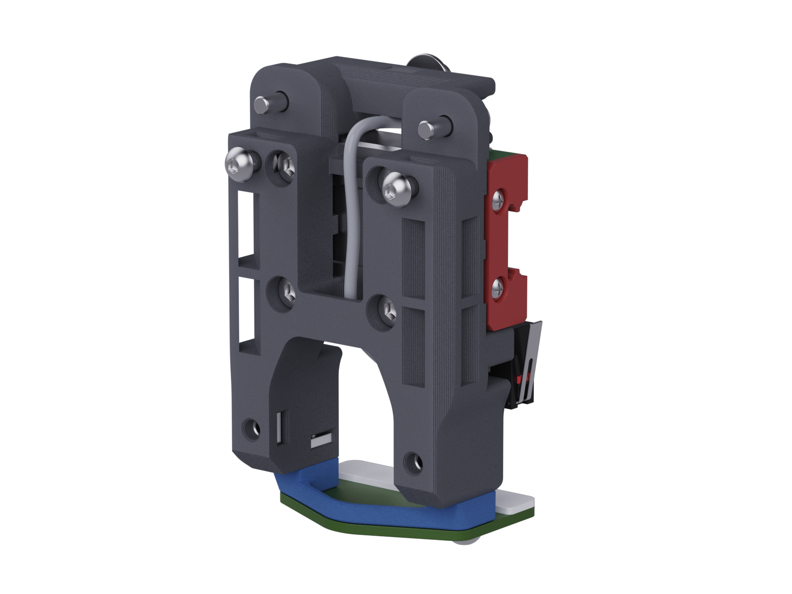

[![CC BY-NC-SA 4.0][cc-by-nc-sa-shield]][cc-by-nc-sa]

# Printed Xol-Carriage v2

> [!WARNING] 
> ### Needs some good testing and feedback 
> I have printed a few and tested things fit, but this hasn't been stress tested yet.

An updated version of the original Xol-Carriage

## Frequently Asked Questions (FAQ)

<dl>

  <dt>Is this a printed carriage?</dt>
  <dd>Yes. This is expanding on the updates made for CNC carriage v2</dd>

  <dt>Do I need the metal pins and tubes for the belt clips?</dt>
  <dd>No. This is currently only for 6mm belts and stock voron trident and 2.4 belt path. The belts are captured between this carriage and the MGN12H carriage on your X rail.</dd>

  <dt>What probes are supported</dt>
  <dd>Xol-Carriage v2 is made to support Beacon/Cartographer probes and has modules to also support Klicky and PCB-Klicky. These Klicky modules also work for Klicky-00.</dd>

  <dt>What size rails will it work on?</dt>
  <dd>Xol Carriage will work on front facing MGN12H rails/carriages.</dd>

</dl>

## Tips

> [!TIP] 
> ### You can help support the development of this project. 
> Donate at https://ko-fi.com/dwtas 

  

#### This work is licensed under a
[Creative Commons Attribution-NonCommercial-ShareAlike 4.0 International License][cc-by-nc-sa].

[![CC BY-NC-SA 4.0][cc-by-nc-sa-image]][cc-by-nc-sa]

[cc-by-nc-sa]: http://creativecommons.org/licenses/by-nc-sa/4.0/
[cc-by-nc-sa-image]: https://licensebuttons.net/l/by-nc-sa/4.0/88x31.png
[cc-by-nc-sa-shield]: https://img.shields.io/badge/License-CC%20BY--NC--SA%204.0-lightgrey.svg

### License clarification regarding non-commercial use:
The non-commercial aspect of this license is for cases where CNC Xol-Carriage is the product, not the use of CNC Xol-Carriage to create products. 
I.e. If you wish to sell CNC Xol-Carriage as a product, you would need to seek a commercial license before doing so.  
It is NOT intended to prevent the use of CNC Xol-Carriage with a printer that you use to provide commercial services. If you want to run CNC Xol-Carriage in your print farm, go right ahead.
